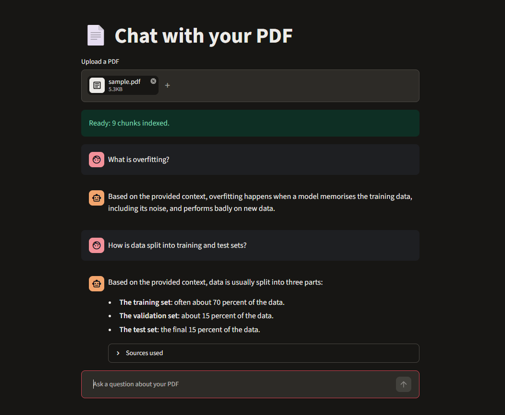

# 📄 Chat with your PDF (RAG Chatbot)

Upload a PDF and ask questions about it. The app finds the most relevant parts of the document and uses an LLM to write an answer based **only** on them, and it shows the sources it used.

**🔗 Live demo:** https://pdf-chatbot-wr4d28s5pzmdnbscq4q3z3.streamlit.app

> The demo runs on a free tier, so it may be asleep. Click "Wake up" if you see it, and the first question can take a minute while the embedding model loads.



## How it works

This is a Retrieval-Augmented Generation (RAG) pipeline written from scratch, without LangChain:

1. **Read**: extract text from the uploaded PDF (`pypdf`).
2. **Chunk**: split the text into sentence-based chunks of about 700 characters, with one sentence of overlap so context isn't lost at the boundaries.
3. **Embed**: convert each chunk into a 384-dimensional vector with a local embedding model (`BAAI/bge-small-en-v1.5` via `fastembed`).
4. **Retrieve**: embed the question and compare it with every chunk using cosine similarity (a NumPy dot product). Keep the top 3.
5. **Generate**: send the question and the top chunks to the Gemini API with an instruction to answer only from that context. If the answer isn't in the document, the bot says so.

Other details:
- **Model fallback:** the app tries a list of Gemini models in order, so one busy or retired model doesn't break it.
- **Sources shown:** every answer has an expandable "Sources used" section with the matching chunks and their scores.

## Tech stack

| Part | Tool |
|---|---|
| Language | Python |
| UI | Streamlit |
| PDF parsing | pypdf |
| Embeddings | fastembed (runs locally, no API) |
| Vector search | NumPy |
| LLM | Google Gemini API (free tier) |
| Hosting | Streamlit Community Cloud |

## Run it locally

```bash
git clone https://github.com/NethmalGunathilake/pdf-chatbot.git
cd pdf-chatbot
python -m venv venv
venv\Scripts\activate        # Windows
# source venv/bin/activate   # macOS / Linux
pip install -r requirements.txt
```

Create a `.env` file with your free Gemini API key from [Google AI Studio](https://aistudio.google.com):

```
GEMINI_API_KEY=your_key_here
```

Then start the app:

```bash
streamlit run app.py
```

## Project structure

```
pdf-chatbot/
├── app.py             # Streamlit web interface
├── rag.py             # RAG logic: load, chunk, embed, retrieve, generate
├── requirements.txt   # Python dependencies
└── docs/              # Screenshots
```

## Limitations

- Works with text-based PDFs only. Scanned PDFs (images) have no extractable text.
- Uses a shared free-tier API key, so heavy use may hit rate limits.
- Retrieval uses the top 3 chunks, so questions that need information from many parts of a long document may be answered incompletely.

## Possible improvements

- Chat memory for follow-up questions
- Support for multiple PDFs
- Streaming answers
- A small evaluation set to measure retrieval quality

## Author

**Nethmal Gunathilake**: Computing and Software Engineering graduate, learning AI engineering.
[GitHub](https://github.com/NethmalGunathilake)
